# Arsitektur Plugin QGIS GeoNode Connector & Panduan Penyesuaian Multi-Instance GeoNode

Dokumen ini menyajikan dua bagian utama:
1. **Arsitektur Sistem Plugin GeoNode Connector**: Blueprint struktural menyeluruh dari arsitektur perangkat lunak plugin (Presentation, Controller, Background Workers, Business Service, REST API, Domain Model, Caching, dan Utilitas) termasuk pembaruan Model/View `QTableView`, enkripsi `QgsAuthManager`, GeoPackage (.gpkg) cache, eliminasi dependensi biner `psycopg2` via `QgsDataSourceUri`, dan WFS-T per-user.
2. **Panduan Penyesuaian Multi-Instance, Delta Sync & Distribusi Multi-Device**: Penjelasan penyelesaian selisih dataset 520 vs 522, migrasi kredensial sensitif ke `QgsAuthManager`, mekanisme *Delta Sync*, manajemen multi-instance dinamis via `QgsSettings`, serta panduan instalasi ke komputer/laptop lain lintas sistem operasi.

---

# ARSITEKTUR PLUGIN GEONODE CONNECTOR

Plugin ini dirancang dengan prinsip **Clean Architecture / Layered Architecture** yang memisahkan antarmuka pengguna (Qt UI), orkestrasi aksi (Controller), background thread workers (QThread), logika bisnis (Business Service), komunikasi jaringan (REST API Client), persistensi cache lokal, dan model domain.

```mermaid
flowchart TD
    subgraph UI_Layer ["1. Presentation Layer (Qt / QGIS UI)"]
        Dialog["GeoNodeConnectorDialog (Main Window)"]
        W_Login["LoginWidget (Server Dropdown + QgsSettings)"]
        W_Dataset["DatasetWidget (QTableView + Virtual Rendering)"]
        W_MyLayers["MyLayersWidget"]
        W_Activity["ActivityWidget"]
        W_Server["ServerWidget (Multi-Instance Dropdown)"]
        W_About["AboutWidget"]
        D_Upload["UploadWizardDialog"]
        D_Metadata["MetadataDialog"]
        D_Sync["SyncDialog / ChangeDetailDialog"]
    end

    subgraph MV_Layer ["2. Model/View & Proxy Architecture"]
        M_Table["DatasetTableModel (QAbstractTableModel)"]
        M_Proxy["DatasetProxyModel (QSortFilterProxyModel - C++ Filter)"]
    end

    subgraph Controller_Layer ["3. Controller / Presenter Layer"]
        C_Login["LoginController"]
        C_Dataset["DatasetController (Non-blocking async + Delta Sync)"]
        C_Import["ImportController"]
        C_Server["ServerController (QgsSettings Multi-Instance Sync)"]
        C_About["AboutController"]
    end

    subgraph Worker_Layer ["4. Background Concurrency Layer (Non-blocking)"]
        WK_Fetch["DatasetFetchWorker (QThread - Full / Delta Pagination)"]
    end

    subgraph Service_Layer ["5. Business Service Layer"]
        S_Login["LoginService"]
        S_Layer["LayerService (Delta Sync + GPKG Cache Manager)"]
        S_Import["ImportService (Native GPKG / WFS / WMS)"]
        S_Sync["SyncService (Per-User WFS-T Transactions + Native QgsDataSourceUri)"]
        S_Upload["UploadService"]
        S_Meta["MetadataService"]
        S_Act["ActivityService"]
    end

    subgraph Cache_Layer ["6. Local Persistence & Standardized Cache"]
        DiskCache[("datasets_cache.json (Instant Startup <0.05s - 522 Datasets)")]
        GpkgCache["cache/gpkg/ (*.gpkg - SQLite + R-Tree Spatial Index)"]
        GeoJsonCache["cache/geojson/"]
        ShpCache["cache/shapefiles/"]
    end

    subgraph Security_Layer ["7. Security & Authentication Architecture"]
        Auth_Mgr["AuthManagerService (QgsAuthManager - Master Password Encryption)"]
        Auth_Cfg[("QGIS Auth Database: qgis-auth.db")]
    end

    subgraph API_Layer ["8. Data Access & API Layer"]
        A_Auth["AuthAPI (/o/token/, /api/v2/users/)"]
        A_Dataset["DatasetAPI (/api/v2/datasets + Supplementary /api/v2/resources)"]
        A_Upload["UploadAPI (/api/v2/uploads)"]
        A_Meta["MetadataAPI (/api/v2/datasets/{pk})"]
        GS_Rest["GeoServer REST API (/geoserver/rest)"]
        GS_WFST["GeoServer OWS WFS-T HTTP Transaction Engine"]
        QGS_Uri["QgsDataSourceUri (Native QGIS PostgreSQL Provider)"]
    end

    subgraph Core_Layer ["9. Models & State Management"]
        M_Session["Session Singleton (Token, User, Server)"]
        M_Layer["Layer Model (Metadata, BBox, OWS URLs, modified)"]
        M_User["User Model"]
        M_Result["ServiceResult (ok/fail wrapper)"]
    end

    subgraph Remote_Host ["10. GeoNode & Geospatial Servers"]
        QGIS_Canvas["QGIS Canvas / QgsProject"]
        GeoNode_Server["GeoNode 4.x / 5.x Web Server"]
        GeoServer_Engine["GeoServer Engine"]
        PostGIS_DB["PostgreSQL / PostGIS Database"]
    end

    %% Relasi Antar Layer
    Dialog --> W_Login & W_Dataset & W_MyLayers & W_Activity & W_Server & W_About
    W_Dataset --> M_Proxy --> M_Table
    W_Login --> C_Login
    W_Dataset --> C_Dataset
    W_Server --> C_Server

    C_Login --> S_Login
    C_Login --> Auth_Mgr
    Auth_Mgr --> Auth_Cfg
    C_Dataset --> S_Layer
    C_Dataset --> WK_Fetch
    WK_Fetch --> A_Dataset
    C_Dataset --> C_Import
    C_Import --> S_Import

    S_Layer --> DiskCache
    S_Layer --> A_Dataset
    S_Login --> A_Auth
    S_Import --> QGIS_Canvas
    S_Import --> GpkgCache
    S_Import -.->|WFS / WMS URI| GeoServer_Engine

    S_Sync --> GS_WFST
    S_Sync --> QGS_Uri
    S_Sync --> GS_Rest
    QGS_Uri --> PostGIS_DB
    GS_WFST --> GeoServer_Engine
    GS_Rest --> GeoServer_Engine

    S_Upload --> A_Upload
    S_Upload --> S_Sync
    S_Meta --> A_Meta
```

---

## 1.1 Rincian Layer Arsitektur & Peningkatan Performa

### 1. Presentation Layer (`ui/widgets/`, `ui/dialogs/`)
* **`GeoNodeConnectorDialog`**: Window utama (`QMainWindow`) yang menampung header status koneksi, navigasi tab horizontal, serta `QStackedWidget`.
* **`DatasetWidget` (Model/View `QTableView` & Virtual Rendering)**:
  * Menggantikan implementasi legacy `QTableWidget` dengan **`QTableView`** yang dipadukan dengan **`QSortFilterProxyModel`**.
  * **Virtual Rendering**: QGIS hanya merender baris yang tampak pada layar (viewport), mengeliminasi alokasi ribuan object C++ `QTableWidgetItem` yang boros memori.
  * **C++ Native Filtering (0ms latency)**: Penyaringan teks pencarian berjalan di level native C++ pada proxy model tanpa iterasi manual Python `setRowHidden()`.
* **`LoginWidget`**: Form autentikasi yang terhubung ke `QgsSettings` untuk pemilihan server secara dinamis.
* **`ServerWidget`**: Form konfigurasi server multi-instance dengan elemen **`QComboBox` preset server** yang terikat ke `QgsSettings`, mendukung perpindahan instan antar-lingkungan server tanpa mengedit file kode.
* **`UploadWizardDialog`**: Wizard dialog modern untuk **Ekspor & Publikasi Dataset Baru** atau pembaruan dataset ke GeoNode:
  * **Sumber Fleksibel**: Pengguna dapat memilih layer yang sedang aktif di kanvas QGIS (`QgsVectorLayer`) maupun memilih file data spasial dari disk (`.gpkg`, `.shp`, `.geojson`) via *file browser*.
  * **Ringkasan Otomatis Layer**: Menampilkan nama layer, tipe geometri (*Point/Line/Polygon*), jumlah fitur, dan sistem koordinat (*CRS/EPSG*).
  * **Standarisasi Format**: Mendukung ekspor ke format GeoPackage (.gpkg - direkomendasikan), GeoJSON, dan Shapefile.
  * **Penyelarasan Style Simbologi (.sld)**: Mendukung ekspor otomatis simbologi layer QGIS ke format OGC Styled Layer Descriptor (`.sld`) dan menjadikannya default style aktif di GeoNode/GeoServer, serta menyediakan tombol ekspor file `.sld` lokal ke komputer.
  * **Layout Responsif & Bebas Horizontal Scroll**: Dialog berukuran pas (*fit*) dengan `ScrollBarAlwaysOff` secara horizontal dan kebijakan penyesuaian konten adaptif.
  * **Pengisian Metadata Standar**: Validasi dan pengisian metadata berstandar SNI/ISO 19115 (Judul, Abstrak, Kategori Tema GeoNode, Kata Kunci, Lisensi, Bahasa).
  * **Monitoring Non-Blocking**: Progress bar interaktif saat mengunggah ke GeoNode Importer (`/uploads/upload`), menyelaraskan style SLD, dan menyegarkan katalog.
* **`ServerWidget` (Aesthetically Modernized Input)**: Form konfigurasi koneksi dengan *input field* timeout yang bersih tanpa tombol stepper panah (`QAbstractSpinBox.NoButtons`), memberikan tampilan minimalis dan elegan.
* **`SyncDialog` & `ChangeDetailDialog`**: Dialog preview dan validasi sebelum melakukan commit atribut/geometri melalui protokol WFS-T.

### 2. Model/View Architecture (`ui/models/dataset_table_model.py`)
* **`DatasetTableModel` (`QAbstractTableModel`)**: Model data tabular murni yang menyajikan kolom PK, Judul Layer, Nama Alternatif, Tipe/Subtype, Status, dan Tanggal Update secara efisien.
* **`DatasetProxyModel` (`QSortFilterProxyModel`)**: Layer proxy di atas model tabel yang menangani sorting multi-kolom dan filtering pencarian instan case-insensitive.

### 3. Concurrency Layer (`services/dataset_worker.py`)
* **`DatasetFetchWorker` (`QThread`)**: Mengambil dataset GeoNode secara asinkron di thread terpisah.
* Mendukung mode **Full Fetch** maupun **Delta Sync** (`since_timestamp`), memancarkan sinyal `pageLoaded(accumulated, count, total)` secara bertahap.

### 4. Business Service Layer (`services/`)
* **`LayerService`**:
  * Mengatur in-memory cache dan **Persistent Disk Cache** (`cache/datasets_cache.json` dengan total 522 dataset).
  * Menyediakan fungsi `sync_delta()` untuk validasi timestamp modifikasi terakhir (`last_modified`) dan penggabungan dataset incremental (`merge_layers`).
* **`SyncService` (Per-User WFS-T & Native `QgsDataSourceUri`)**:
  * **Per-User WFS-T Transactions**: Seluruh transaksi pengeditan (Insert, Update, Delete fitur dan geometri) dialihkan melalui protokol WFS-T GeoServer berbasis hak akses akun masing-masing pengguna di GeoNode.
  * **Eliminasi `psycopg2` via `QgsDataSourceUri`**: Pustaka eksternal `psycopg2` dieliminasi sepenuhnya. Inspeksi tabel dilakukan langsung melalui provider native QGIS `"postgres"` dengan connection pooling bawaan C++ yang stabil di Windows, macOS, dan Linux.
* **`ImportService` (GeoPackage Standardization)**:
  * Mendukung standardisasi cache vektor lokal ke format tunggal **GeoPackage (.gpkg)** via `QgsVectorFileWriter.writeAsVectorFormatV3()`.

### 5. Security & Authentication Layer (`utils/auth_manager.py`)
* **`AuthManagerService` (`QgsAuthManager`)**:
  * Mengenkripsi kredensial pengguna (username, token, password) ke basis data autentikasi QGIS (`qgis-auth.db`) yang terlindungi *Master Password*.
  * Menghilangkan risiko kebocoran file teks biasa `.env` pada saat plugin didistribusikan ke komputer staf.

---
